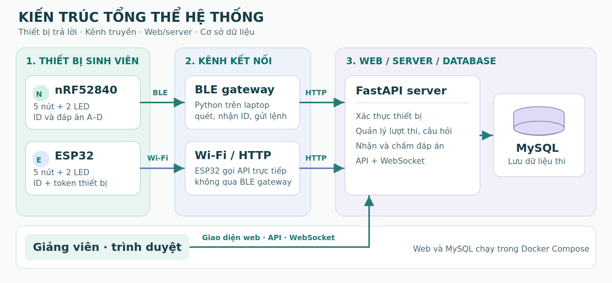
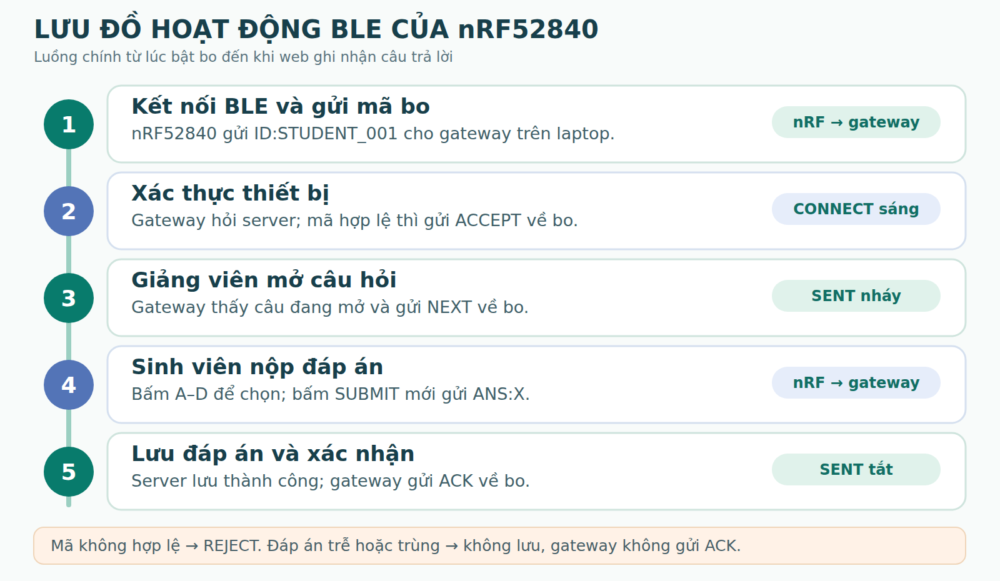
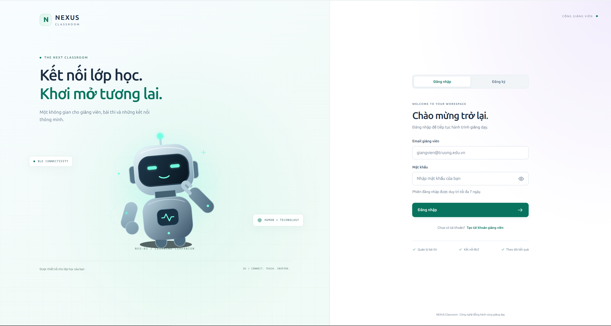
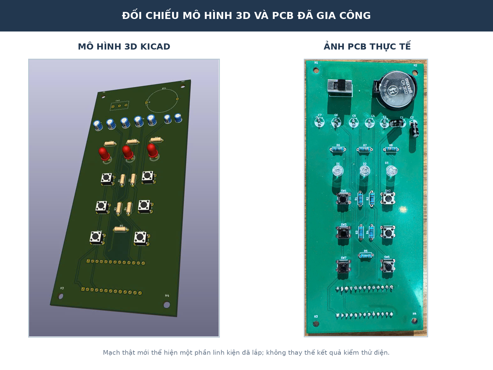
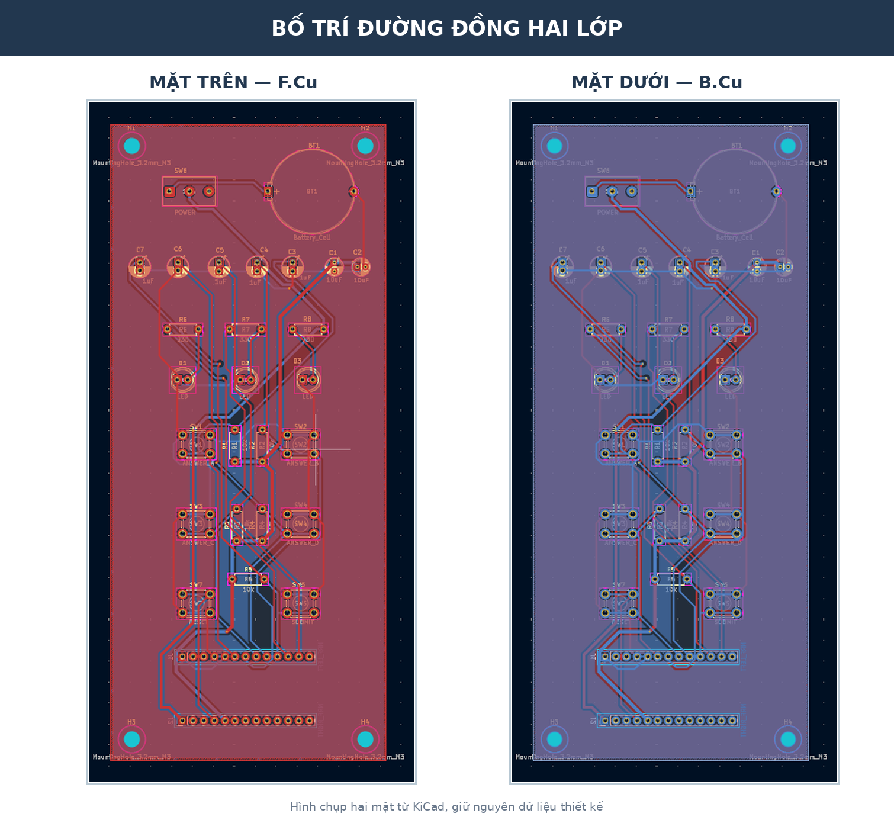

# Hệ thống trắc nghiệm tương tác sử dụng BLE và Wi-Fi

Đây là hệ thống trả lời trắc nghiệm trong lớp học. Giảng viên quản lý lớp, sinh viên và đề thi trên web; người học trả lời bằng thiết bị năm nút. Server xác thực thiết bị theo từng lượt thi, lưu đáp án vào MySQL, chấm điểm và cung cấp kết quả để xem hoặc xuất Excel.

## Thành viên

| Họ và tên | MSSV |
|---|---:|
| Vũ Phạm Đức Văn | 23134064 |
| Phạm Đức Huy | 23134026 |
| Nguyễn Thiện Nhân | 23134041 |

Đề tài môn IoT, Khoa Cơ khí – Bộ môn Cơ điện tử, Trường Đại học Công nghệ Kỹ thuật TP. Hồ Chí Minh. Giảng viên hướng dẫn: TS. Bùi Hà Đức.

## Kiến trúc hệ thống

Hệ thống có hai lựa chọn thiết bị trả lời. nRF52840 gửi dữ liệu qua BLE tới gateway Python chạy trên laptop; ESP32 kết nối Wi-Fi và gọi API trực tiếp. Cả hai đường truyền đều đi tới FastAPI và MySQL. Trình duyệt giảng viên làm việc với web/API và nhận cập nhật qua WebSocket.

*nRF52840 dùng BLE gateway; ESP32 dùng Wi-Fi/HTTP trực tiếp tới server.*

## Chức năng chính

- Quản lý tài khoản giảng viên, môn học, lớp và danh sách sinh viên.
- Tạo bài thi, nhập câu hỏi từ DOCX/PDF có lớp văn bản và nhập danh sách từ Excel.
- Ghép thiết bị với sinh viên ở đầu mỗi lượt thi; danh sách ghép trong lượt thi là nguồn xác định chủ sở hữu đáp án.
- Trình chiếu câu hỏi, theo dõi trạng thái thiết bị, mở câu tiếp theo hoặc kết thúc bài thi.
- Từ chối đáp án của câu đã đóng, đáp án gửi trễ, nộp trùng hoặc thiết bị không thuộc lượt thi.
- Chấm điểm tối đa 10, xem thống kê và xuất bảng điểm cùng chi tiết câu trả lời ra Excel.

Theo báo cáo, cơ sở dữ liệu MySQL có 19 bảng cho tài khoản giảng viên, lớp/môn, sinh viên, lượt thi, câu hỏi, thiết bị, trạng thái kết nối và đáp án. Mỗi lượt thi chốt ghép thiết bị riêng; server ngăn dùng một thiết bị cho nhiều sinh viên trong cùng lượt và ngăn nộp lặp cho cùng câu.

## Luồng thiết bị nRF52840

Thiết bị có các nút A/B/C/D, nút SUBMIT, LED kết nối và LED gửi. Thiết bị quảng bá BLE; gateway nhận mã ID rồi hỏi server để xác thực. Khi server chấp nhận, gateway gửi ACCEPT. Lúc giảng viên mở câu, gateway gửi NEXT; người học chọn đáp án rồi nhấn SUBMIT để gửi ANS:X. Sau khi server lưu đáp án thành công, gateway gửi ACK. ACK xác nhận đã lưu, không báo đáp án đúng hay sai.

Mã firmware và mô tả state machine ở [NRF52840_Quiz_Remote_src/main/main.ino](NRF52840_Quiz_Remote_src/main/main.ino) và [README luồng firmware](NRF52840_Quiz_Remote_src/main/README.md). Mã gateway BLE cần chạy riêng trên máy có Bluetooth; gateway không nằm trong các tệp hiện có của repository.

## Giao diện web

Web cung cấp trang đăng nhập giảng viên và các chức năng quản lý lớp, thiết bị, bài thi và kết quả. Web và MySQL được triển khai bằng Docker Compose; FastAPI xử lý API và dữ liệu bài thi.

Xem cách chạy và cấu hình trong [web/README.md](web/README.md).

## Cấu trúc repository

- `web/`: giao diện giảng viên, FastAPI, API và cấu hình Docker Compose.
- `NRF52840_Quiz_Remote_src/main/`: firmware BLE cho thiết bị nRF52840 và tài liệu luồng hoạt động.
- `NRF52840_Quiz_Remote/`: sơ đồ nguyên lý, PCB KiCad và Gerber.
- `Case/`: các tệp thiết kế và STL liên quan đến vỏ thiết bị.
- `docs/images/`: ảnh kiến trúc, giao diện, luồng BLE và PCB trích từ báo cáo.

## Phần cứng

PCB nRF52840 được thiết kế hai lớp, có các đầu vào nút nhấn, hai LED trạng thái và LED nguồn. Báo cáo ghi kích thước thiết kế 66 × 152 mm, các nút chọn A/B/C/D và SUBMIT, cùng các thành phần nguồn và reset. Ảnh bên dưới đối chiếu mô hình PCB với ảnh bo đã gia công; ảnh chỉ ghi nhận một phần linh kiện đã lắp, không thay cho phép thử điện.

Ảnh đường mạch hai lớp F.Cu/B.Cu:

Báo cáo có mô tả quy trình thiết kế vỏ và một ảnh chi tiết vỏ in. Tuy nhiên báo cáo cũng nêu chưa có tệp SolidWorks/STL và chưa ghi nhận kiểm tra lắp ghép hoàn chỉnh; vì vậy phần vỏ vẫn cần được xác nhận thêm.

## Kiểm thử và giới hạn

Báo cáo ghi nhận một lượt thử nRF từ thao tác chọn C trên Serial đến ANS:C, nhận ACK và lưu lựa chọn C vào database. Báo cáo chưa có số liệu về độ trễ, tỷ lệ mất gói BLE hoặc kiểm thử tải với nhiều thiết bị cùng lúc.

Các lưu ý bảo mật được nêu trong báo cáo: BLE chưa có cơ chế chống giả mạo mạnh; ESP32 dùng HTTP trong mạng LAN và token thiết bị phải được giữ kín. Không đưa thông tin xác thực vào firmware công khai hoặc triển khai API trực tiếp lên Internet nếu chưa bổ sung bảo vệ phù hợp.

## Tài liệu

- [Báo cáo dự án (DOCX)](https://docs.google.com/document/d/1qnYOhXeeTpFeyJ0GafD6C87CJyP0sUIl/edit)
- [README hướng dẫn web](web/README.md)
- [README luồng firmware nRF52840](NRF52840_Quiz_Remote_src/main/README.md)
